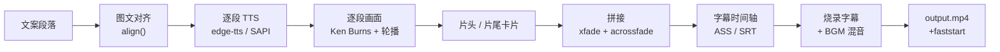

# 文字图片转视频工具 · TextToVideo

> 把「一段文案 + 几张配图」一键变成带配音、字幕、转场、背景音乐和片头片尾的成品短视频。
> 纯本地运行，不依赖任何在线剪辑平台，专为抖音 / 视频号 / 小红书 / B 站等自媒体场景设计。

<p align="left">
  
  
  
  
</p>

---

## 这是什么

一个 Tkinter 桌面工具：左边贴文案、右边选图片，点一下「开始生成视频」，就得到一条可以直接发布的 MP4。

它解决的核心问题是**图文视频里最烦人的三件事**：

1. **配音和画面对不齐** —— 用在线 TTS 的词级时间戳驱动字幕，字幕卡在真实发音上，不靠字数估算。
2. **段落数和图片数不相等** —— 提供三种对齐策略，不强制一张图配一段话。
3. **静态图太死板** —— Ken Burns 缓慢推拉 + 多图轮播 + 段落转场，让图片「有呼吸感」。

## 功能特性

### 画面

| 能力 | 说明 |
| --- | --- |
| 平台预设 | 抖音/快手、视频号（1080×1920）、小红书（1080×1440）、B 站/西瓜（1920×1080）、竖屏/横屏 720p、正方形 1:1，切换预设时字幕字号与安全区跟着变 |
| 图片填充 | **裁剪铺满**（撑满画面，边缘裁掉）或 **模糊背景**（保留完整画面，两侧补高斯模糊底） |
| 画面动效 | Ken Burns 缓慢推拉，5 种运镜变体轮流使用；幅度可选 关闭 / 轻微 / 标准 / 明显 |
| 多图轮播 | 每段按设定秒数在整组图之间轮播，一张图也能撑满长段落 |
| 段落转场 | 淡入淡出、溶解、向左推移、向上推移、圆形展开，转场时长可调（段落过短时自动收窄） |

### 声音与字幕

- **双引擎 TTS**：默认 [edge-tts](https://github.com/rany2/edge-tts) 在线合成，内置晓晓、云希、云健、东北话、陕西话、粤语、中国台湾腔等中文音色；断网时自动降级到 Windows 系统语音（System.Speech），保证永远出得来片子。
- **语速可调**：`-50%` ~ `+50%`，在线/离线引擎都会跟随。
- **字幕精准对齐**：在线引擎返回 WordBoundary 词级时间戳，字幕切句后按真实发音时间排布，长句自动拆成多条；可调字号、文字色、描边色、描边粗细、显示位置（底部/中央/顶部）与距边距。
- **字幕样式**：可选「去掉句尾标点」，白色字 + 黑色描边最通用；默认按平台给出竖屏 58~66 号的建议值。
- **另存 .srt**：需要上传平台字幕时，可同时导出一份标准 SRT。
- **背景音乐**：自动循环铺满全片，音量独立可调，结尾 2 秒自动淡出。

### 片头片尾

标题卡式片头 + 关注引导式片尾：主标题、副标题、背景图（留空则复用第一张插图）、停留时长、可选配音文字。背景自动做高斯模糊 + 压暗 + 缓慢推近，配淡入淡出。

### 工程化

- **项目文件 `.t2v`**：文案、图片清单、全部参数存为 JSON，`Ctrl+S` 保存、`Ctrl+O` 打开，下次接着改。
- **实时预估**：输入时即时显示「X 段文字 + Y 张图 → N 个段落，共约 M 字，预计时长」，不用先跑一遍才知道多长。
- **可取消**：生成过程中随时取消，正在运行的 ffmpeg 进程会被立即终止。
- **进度日志**：以「第几段 / 共几段」的粒度输出到界面日志区。
- **打包自检**：`TextToVideo.exe --selftest` 校验 ffmpeg 定位、语音引擎和完整视频生成链路，结果写入临时目录日志。

## 运行环境

- **Windows 10 / 11**（依赖 Windows 系统语音做离线兜底，并对高 DPI 屏幕做了适配）
- **Python 3.10+**（打包脚本默认找 3.12，且必须带 `tcl/tk`）
- **ffmpeg / ffprobe**：放在项目的 `bin/` 目录下即可，程序会按 `bin/` → PyInstaller 解压目录 → 系统 `PATH` 的顺序查找

## 快速开始

```bash
git clone git@github.com:qqbn2027/image2video.git
cd image2video

# 1) 准备 ffmpeg：把 ffmpeg.exe 与 ffprobe.exe 放进 bin/
#    下载地址：https://www.gyan.dev/ffmpeg/builds/  (essentials 版即可)

# 2) 安装依赖
pip install -r requirements.txt

# 3) 启动
python main.py
```

首次启动会在后台拉取在线音色列表（失败则用内置默认列表，不阻塞界面）。

### 自检

```bash
python main.py --selftest
# 日志同时写入 %TEMP%\t2v_selftest.log
```

### 打包成免安装 exe

```bat
build_exe.bat
```

脚本会依次：生成图标 → 清理旧构建 → PyInstaller 打包（`--onedir`，内嵌 ffmpeg/ffprobe，收集 `edge_tts` 全部资源）→ 重命名产物。

> 产物在 `dist/` 下，**分发时要发整个文件夹**，不能只发 exe。

## 使用流程

界面按「① 文案与图片 → ② 画面 → ③ 声音与字幕 → ④ 片头片尾」四个标签页组织，依次填完即可。

1. **① 文案与图片**：粘贴文案，**段落之间空一行**；添加图片并调整顺序（顺序即画面顺序）。
   选择「图文对应」策略：
   - *自动分组* —— 段落多于图片时，把连续段落平均合并到每张图；段落少于图片时只使用前几张。
   - *图片循环* —— 每段独立成段，图片按顺序轮流复用。
   - *严格一一对应* —— 数量不相等直接报错，适合精确定稿。
2. **② 画面**：选平台预设 / 填充方式 / 动效幅度 / 轮播秒数 / 转场类型与时长。
3. **③ 声音与字幕**：选音色、语速，决定是否离线优先、是否导出 SRT，配背景音乐与音量，调字幕样式。
4. **④ 片头片尾**：按需启用，填标题与停留时长。
5. 指定输出路径 → **开始生成视频**。

`示例素材/` 里有一份现成的电影资讯文案与三张配图，可直接拿来跑通全流程。

## 合成管线



几个实现要点：

- **每段只编码一次**：多图轮播在同一条 `filter_complex` 里用 `concat` 完成，避免中间文件反复转码。
- **放大 2 倍再运镜**：`zoompan` 作用在 2× 画布上再降采样，显著减少推拉时的抖动与锯齿。
- **时间轴按转场重叠精确补偿**：`xfade` 的 `offset` 与字幕起点用同一套 `timeline()` 计算，段数再多字幕也不会累积漂移。
- **中间件用快速预设**：后面还要再编码一次（烧字幕 / 混 BGM）时，片段用 `veryfast` + `crf 16` 换取速度与画质的平衡。
- **收尾一步到位**：`subtitles` 滤镜烧 ASS、`amix` 混 BGM、`+faststart` 让 moov 前置，方便网页和移动端秒开。

## 项目结构

```
image2video/
├── main.py                # 入口：DPI 适配 / --selftest 自检 / 启动 GUI
├── app/
│   └── gui.py             # 四标签页界面、项目读写、生成线程与日志
├── core/
│   ├── align.py           # 图文对齐：自动分组 / 图片循环 / 严格一一对应
│   ├── cards.py           # 片头片尾卡片（模糊压暗背景 + 居中大字）
│   ├── config.py          # 平台预设、转场/动效/填充枚举、字幕默认样式
│   ├── project.py         # .t2v 项目文件读写（JSON）
│   ├── subtitles.py       # ASS / SRT 生成：切句、分行、按词级时间戳排布
│   ├── tts.py             # edge-tts 在线合成 + Windows SAPI 离线兜底
│   ├── utils.py           # ffmpeg/ffprobe 定位、时长探测、可取消的进程执行
│   └── video.py           # 合成管线：分段 → 转场拼接 → 字幕/混音收尾
├── bin/                   # ffmpeg.exe / ffprobe.exe（自行放置，不入库）
├── build_exe.bat          # 一键打包脚本
├── make_icon.py           # 生成 app.ico
├── rename_dist.py         # 打包产物重命名
└── 示例素材/              # 示例文案与配图
```

## 常见问题

**Q：提示「未找到 ffmpeg」？**
把 `ffmpeg.exe` 和 `ffprobe.exe` 放到程序目录下的 `bin/` 文件夹；打包版放到 `TextToVideo.exe` 同级的 `bin/`。

**Q：没有声音 / 语音合成失败？**
在线引擎需要联网；勾选「离线优先」会改用 Windows 系统语音。若系统没有安装中文语音包，请在「设置 → 时间和语言 → 语音」中添加。

**Q：字幕比我说话快或慢？**
在线引擎下字幕由词级时间戳驱动，一般无需调整。使用离线引擎时没有词级时间戳，会退回按字数分配；此时调整语速或手动断句（多用句号）效果最好。

**Q：生成很慢？**
主要耗时在编码。降低分辨率（选 720p 预设）、缩短轮播秒数、关闭字幕烧录（转码次数减少）都能明显提速；动效「关闭」也能省一点。

**Q：中文字幕乱码 / 不显示？**
程序使用 `Microsoft YaHei`（Windows 自带）。若系统精简掉了该字体，把 `core/config.py` 里的 `font` 改成已安装的中文字体即可。

## 已知限制

- 仅支持 Windows：离线 TTS 走 System.Speech，DPI 适配走 Win32 API。
- 字幕烧录依赖 ffmpeg 的 `subtitles` 滤镜（需 libass），推荐使用官方 essentials 构建。
- 片头片尾卡片固定为「标题 + 副标题」样式，不支持自由排版。

## License

MIT
